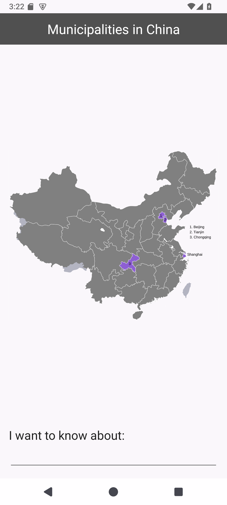
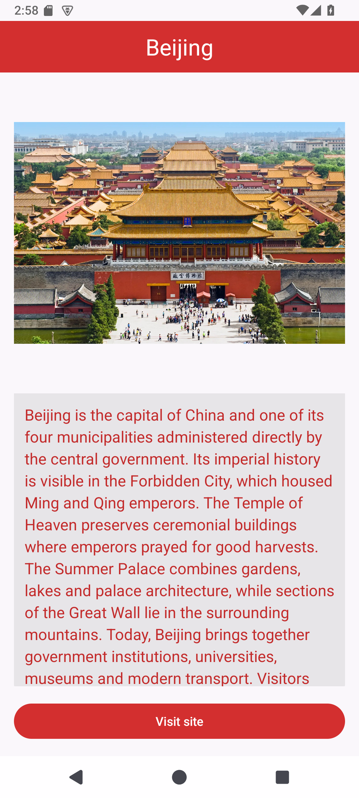
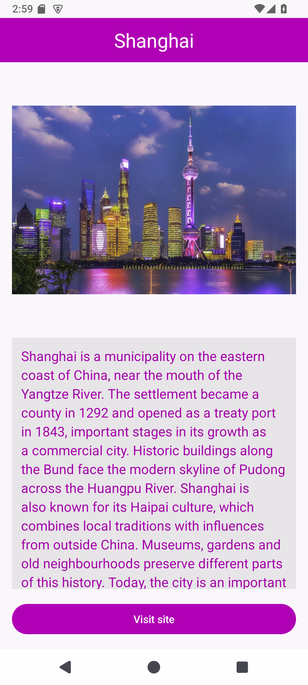
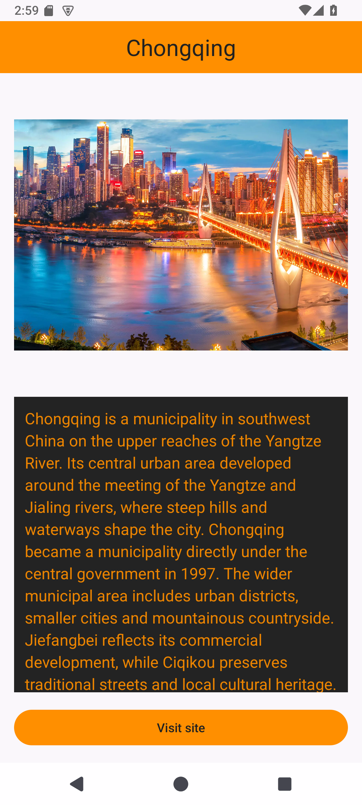
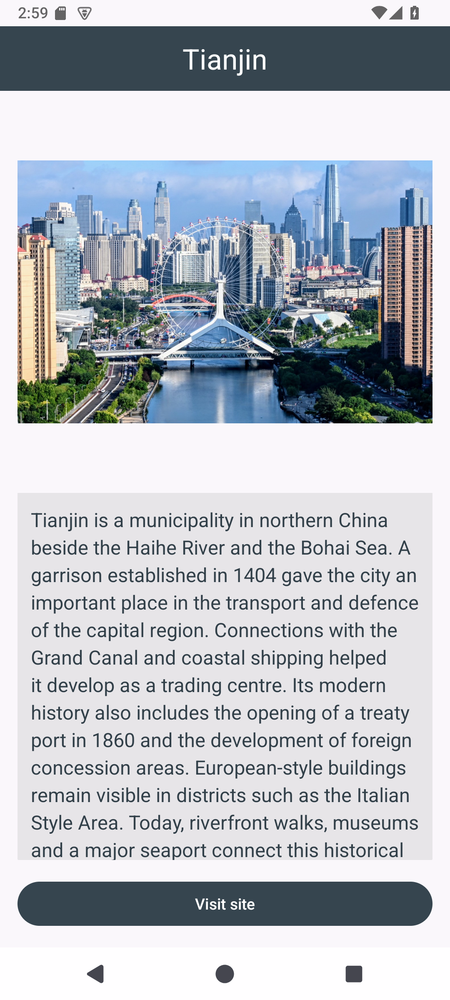

# Chinese Municipalities - Practical 5

Student ID: **20243007027**

A Java and XML Android application created from Android Studio's Empty Views Activity template. Enter Beijing, Shanghai, Tianjin or Chongqing and press **Go** on the keyboard. Names are accepted regardless of case. Unsupported or empty input displays an error on the main screen.

The second screen shows the selected city's photograph and a researched summary, with its own colour scheme. The information scrolls independently of the **Visit site** button. That button opens the corresponding official municipal website using an implicit intent.

## Run

1. Open this repository's root folder in Android Studio with support for Android Gradle Plugin 9.4.1.
2. Allow Gradle to sync. The project uses the included Gradle 9.6.0 wrapper, JDK 25 daemon criteria, and Android SDK 37.
3. Choose an emulator or device running Android 7.0 / API 24 or newer, select `app`, and click Run.

On Windows, build and run the local tests with:

```text
gradlew.bat :app:assembleDebug :app:testDebugUnitTest :app:lintDebug
```

With an emulator or device connected:

```text
gradlew.bat :app:connectedDebugAndroidTest --no-configuration-cache
```

## Structure

- `MainActivity` displays the map, validates input and starts the explicit intent.
- `TextProcessor` normalises supported names and returns `null` for invalid input.
- `Municipality` validates its intent extra and selects the image, summary, colours and official website.
- Reusable text, colours and summaries are Android resources. The array order is Beijing, Shanghai, Chongqing, Tianjin, following the practical's explicit instruction.

The course-supplied map is a PNG, so its actual format is retained. Original image files are unchanged. The adaptive and legacy launcher icons were generated with Image Asset from the supplied `app_logo.png`, at 60% foreground size with a black background.

See [research sources](docs/sources.md) and [verification results](docs/testing.md).

## Screenshots

| Main | Beijing | Shanghai | Chongqing | Tianjin |
| --- | --- | --- | --- | --- |
|  |  |  |  |  |
